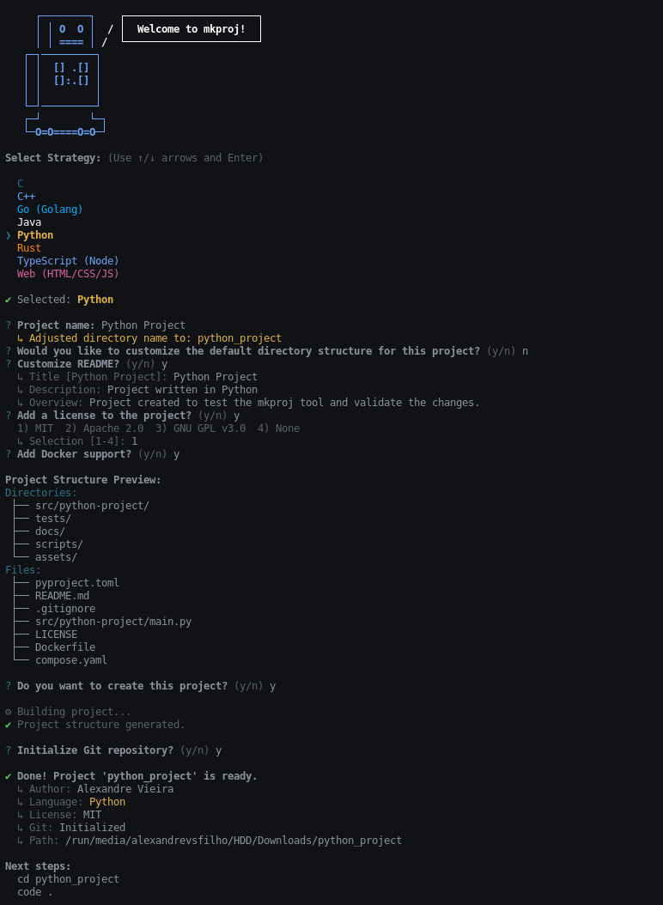
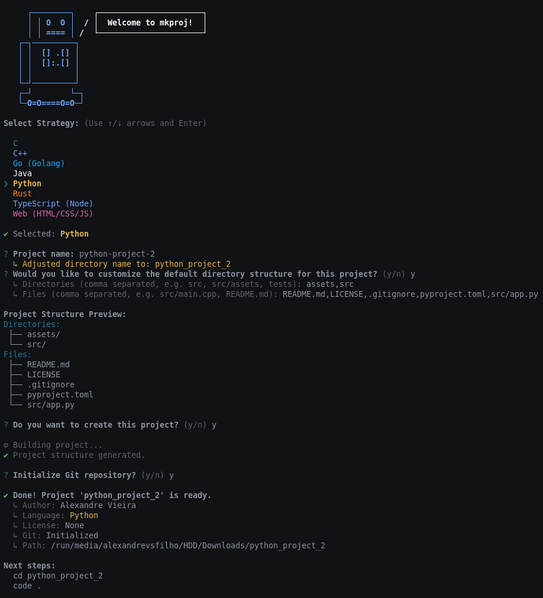
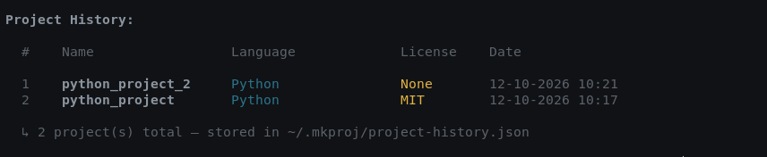
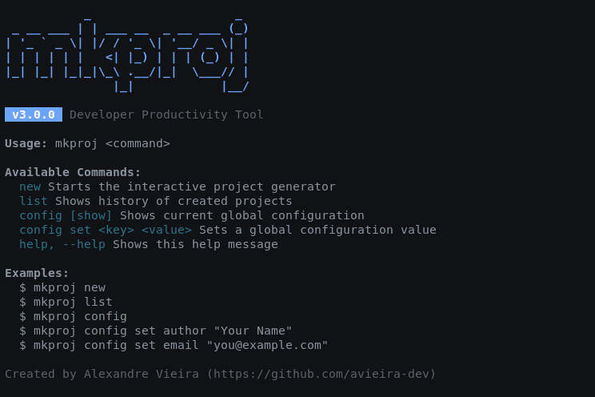
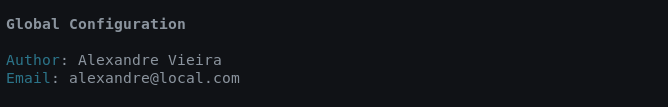

<div align="center">
    <h1>mkproj</h1>
    <p>A fast and flexible CLI tool to scaffold structured projects in multiple programming languages.</p>
    <p>
        
        
        
        
        
        
    </p>
</div>

---

## Overview

**mkproj** eliminates the repetitive work of setting up new projects. Whether you are starting a microservice in Python, a system tool in C/C++, or an enterprise application in Java, mkproj generates a professional, consistent directory tree and all necessary boilerplate — in seconds.

> [!IMPORTANT]  
> **mkproj v3.0.0** is now stable. This major release introduces custom structure scaffolding, interactive project previews, global configuration, color-coded menus, Docker support, and streamlined project creation workflows.

---

## Table of Contents

- [Showcase](#showcase)
- [Features](#features)
- [Supported Languages](#supported-languages)
- [Installation](#installation)
    - [Clone the repository](#1-clone-the-repository)
    - [Make the entry point executable](#2-make-the-entry-point-executable)
    - [Create a global symlink (Linux / macOS)](#3-create-a-global-symlink-linux--macos)
- [Usage](#usage)
    - [First-time setup](#first-time-setup)
    - [Creating a project](#creating-a-project)
    - [Listing projects](#listing-projects)
- [Project Structure](#project-structure)
- [Roadmap](#roadmap)
- [Author](#author)
- [License](#license)

---

## Showcase

<p align="center">
    <em>Interactive strategy selection and project scaffolding with tree preview</em><br>
    <br><br>
    <em>Custom directory and file structure setup on the fly</em><br>
    <br><br>
    <em>Project history log (`mkproj list`)</em><br>
    <br><br>
    <em>Help menu and command overview (`v3.0.0`)</em><br>
    <br><br>
    <em>Global author and email configuration (`mkproj config`)</em><br>
    
</p>

---

## Features

- **Custom Structures** — Define your own custom directories and files on the fly, breaking away from standard templates when needed
- **Structure Preview & Confirmation** — Inspect the generated directory tree and file layout before writing anything to disk
- **Smart Scaffolding** — Generates complete directory trees, build files (CMake, Cargo, Go Mod, Maven, etc.), and starter documentation
- **Global Configuration** — Author and email set once via `mkproj config set`, applied to every project automatically
- **Integrated Git Automation** — Initializes the repository and creates the first commit automatically
- **Docker Support** — Automatically generates tailored `Dockerfile` and `compose.yaml` files on demand
- **Multi-language Support** — Eight languages and environments out of the box
- **Refined Interactive UI** — Menus with color coding, progress spinners, and clear next-step guidance
- **Modern Standards** — Follows PEP 621 for Python, Maven layout for Java, standard Go project structure, and more
- **Safety Guardrails** — Prevents accidental overwrites and validates project names before creation

---

## Supported Languages

| Language / Environment | Build System               | Notes                      |
|------------------------|----------------------------|----------------------------|
| Python                 | `pyproject.toml` (PEP 621) | Virtual env ready          |
| C                      | CMake                      | Standard layout            |
| C++                    | CMake                      | Standard layout            |
| Go                     | Go Modules                 | Standard project structure |
| Java                   | Maven                      | Enterprise-style layout    |
| Rust                   | Cargo                      | `Cargo.toml` included      |
| TypeScript             | `package.json`             | ESM ready                  |
| Web                    | —                          | HTML / CSS / JS boilerplate|
| Custom                 | User-defined               | Free structure layout      |

---

## Installation

### 1. Clone the repository

```bash
git clone https://github.com/avieira-dev/mkproj-cli.git
cd mkproj-cli
```

### 2. Make the entry point executable

```bash
chmod +x main.py
```

> [!TIP]  
> Ensure `main.py` has the shebang line at the top: `#!/usr/bin/env python3`

### 3. Create a global symlink (Linux / macOS)

```bash
sudo ln -s "$(pwd)/main.py" /usr/local/bin/mkproj
```

Once linked, `mkproj` is available system-wide from any terminal session.

> [!NOTE]  
> To uninstall, simply remove the symlink:

```bash
sudo rm /usr/local/bin/mkproj
```

---

## Usage

### First-time setup

Before creating projects, configure your global author information:

```bash
mkproj config set author "Your Name"
mkproj config set email "you@example.com"
```

To verify your configuration:

```bash
mkproj config
```

> [!NOTE]  
> You can also use `mkproj config show`

### Creating a project

```bash
mkproj new
```

Follow the interactive menu to select a language, enter your project name, customize the README, add a license, and configure Docker. mkproj handles the rest

### Listing projects

```bash
mkproj list
```

---

## Project Structure

```text
mkproj-cli/
├── assets
├── commands/       
├── languages/      
├── templates/
|   ├── c_language/         
|   ├── cpp/
|   ├── go/
|   ├── java/
|   ├── licenses/
|   ├── python/
|   ├── rust/
|   ├── typescript/
|   └── web/  
├── utils/ 
├── .gitignore    
├── LICENSE     
├── main.py         
└── README.md
```

---

## Roadmap

| Feature                                                         | Status                      |
|-----------------------------------------------------------------|-----------------------------|
| Support for 8 core languages/environments                       | ████████████████████ `100%` |
| Global author and email configuration                           | ████████████████████ `100%` |
| Integrated Git automation                                       | ████████████████████ `100%` |
| Docker support (automated `Dockerfile` & `compose.yaml`)        | ████████████████████ `100%` |
| Custom interactive structure definition & preview at creation   | ████████████████████ `100%` |
| Custom user templates (`mkproj template save/load`)             | ░░░░░░░░░░░░░░░░░░░░ `0%`   |

---

## Author

**Alexandre Vieira**  
GitHub: [@avieira-dev](https://github.com/avieira-dev)

---

## License

Distributed under the [MIT License](LICENSE). See `LICENSE` for details.